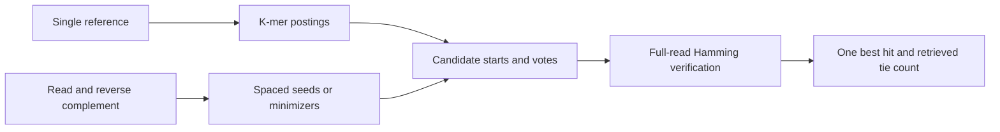

# Short-read aligner

A small Python seed-and-extend aligner that makes its correctness boundary visible. It indexes reference k-mers, searches both read orientations and verifies candidates using full-length Hamming distance. This standalone portfolio project derives from Roee Tekoah's computational genomics coursework, with later AI-assisted packaging and independent evidence; [provenance and contribution boundaries](docs/provenance.md) are explicit.

The scope is **ungapped, independent read mapping against one reference sequence**. There is no pairing, indel, clipping, quality-weighted scoring, MAPQ or biological peak interpretation.



## Run a small example

Python 3.10 or later is required; Python 3.13.13 on Windows was tested. From this repository root, no installation or third-party runtime packages are needed:

```console
python -m short_read_aligner --reference examples/reference.fa --reads examples/reads.fastq --output example.tsv
```

The destination must be new. Compare it with [the oracle-verified expected TSV](examples/expected.tsv). The seven synthetic records cover forward/reverse hits, one/two substitutions, an over-budget read, repeated best hits and unknown bases. The reference and FASTQ together are under 1 KB. No supplied sequencing data is distributed.

Optional installation: `python -m pip install -e .` adds the `short-read-aligner` command. The runtime needs no dependencies; installation uses setuptools. A no-network runtime route is the command above. See [reproduction instructions](docs/reproduce.md) for isolated installation and verification.

## Behavior and guarantee

Defaults are k=12, at most two mismatches, no hit cap, one required seed vote, and complete candidate verification. Every in-bounds alignment within budget is retrieved **when the read and aligned reference region contain only ACGT and L≥(e+1)k**. At the defaults, that means read length ≥36. The representative follows vote/discovery order; it need not be leftmost. Tie counts cover `(position,strand)` pairs. TSV coordinates are zero-based and half-open, including reverse-strand hits.

Accepted shorter reads can miss alignments. N compares literally during scoring but cannot seed. Hit suppression, vote thresholds, minimizer geometry and perfect-match early exit change what can be established. In particular, the original k=15 setting at lengths 36/40 does not guarantee two-substitution sensitivity: executable counterexamples destroy every seed. [Exact contract](docs/contract.md) · [proof, counterexamples and complexity](docs/algorithm.md).

## Evidence

```console
python tools/check.py
python tools/make_fixtures.py --check
python benchmarks/run.py --output benchmark-output
```

The suite has **16 tests, 120,400 exhaustive cases plus two targeted oracle comparisons, zero failures and zero skips**. An independent oracle enumerates every full-length window and both strands. Tests compare all acceptable alignments, the minimum score and tie counts within the proved regimes, then separately assert known failures outside them. They also exercise strict input validation and the CLI.

Fixed, fingerprinted synthetic benchmarks use random, repeat-rich and deliberate seed-disruption inputs, matching Hamming budget/strand policy and reporting build time separately from alignment. The default recovers every oracle-mappable read in all three workloads. Longer 15-base seeds miss 11/120, 6/121 and 2/4 mappable reads respectively; this is observed retrieval loss, not an inferred biological error rate. The minimizer variant stores fewer reference positions on the two larger fixtures but is slower. One exact-exit ablation preserves observed best scores while losing tie counts on 20 repeat-rich reads and one stress read. Timing and memory claims are bounded to these tiny fixtures and this Python implementation. [Measured results and tradeoffs](docs/benchmarks.md) · [raw benchmark evidence](evidence/benchmark/results.json).

## Release boundary

Course originals were preserved; supplied datasets, instructor material, student identifiers, historical report PDFs and downstream analyses are excluded. Original Bowtie2 timings are not used as a matched comparison. The package and reproduction route are verified. Publication does not grant a general reuse license. [License status](LICENSE.md) · [verification record](docs/release-readiness.md).
